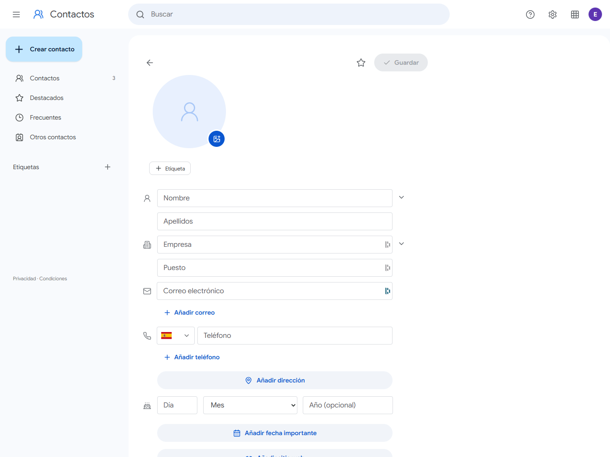
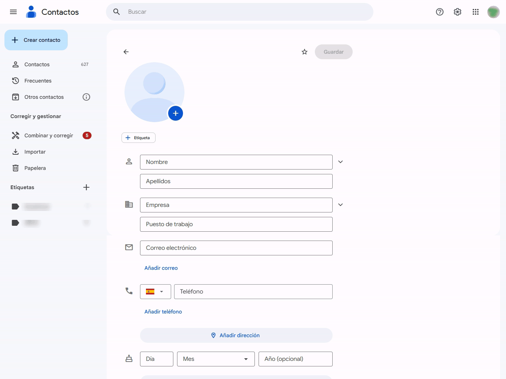

# Google Contacts Layout Clone

An independent visual clone of Google Contacts, built with React and Vite. Explore the interface layout and contact form across desktop and mobile screen sizes. Demo contacts are stored locally in the browser.

## Requirements

- Node.js 18 or later
- npm

## Run locally

```bash
npm install
npm run dev
```

Open the URL printed by Vite (usually [http://localhost:5173](http://localhost:5173)). The new-contact form is available at `/new`.

To create and preview a production build:

```bash
npm run build
npm run preview
```

## Automated layout checks

[`utilities/checker-layout.js`](utilities/checker-layout.js) automates layout checks for the clone and Google Contacts. Open a blank, unsaved new-contact form (`/new` in the clone or [Google Contacts](https://contacts.google.com/new)), open the browser developer console, paste the script, and run one of these commands:

```js
await runCheckerLayout() // Check all available fields
await runCheckerLayout(["Sitio web", "Persona relacionada"]) // Check selected fields
```

The checker expands the form, fills two rows of repeatable fields, leaves a third row blank, and records element sizes and computed CSS in a JSON report. It downloads `checker-layout-clone.json` or `checker-layout-google-contacts.json`. It does not save the contact.

## Gallery

Both GIFs pan from top to bottom in a 4:3 frame.

<table>
  <tr>
    <td align="center" width="50%"><br>Clon</td>
    <td align="center" width="50%"><br>Original</td>
  </tr>
</table>

## Features

- Responsive desktop and mobile layout.
- Create, edit, and delete contacts.
- Search by first name, last name, email, phone, or company.
- Store demo data in `localStorage`.
- Add contact details and supplementary fields.

## Disclaimer

This is an independent, unofficial project. I am not affiliated with Google, and this project is not endorsed by or connected to Google.

## License

Released under the MIT License. See [LICENSE](LICENSE) for the full text.
